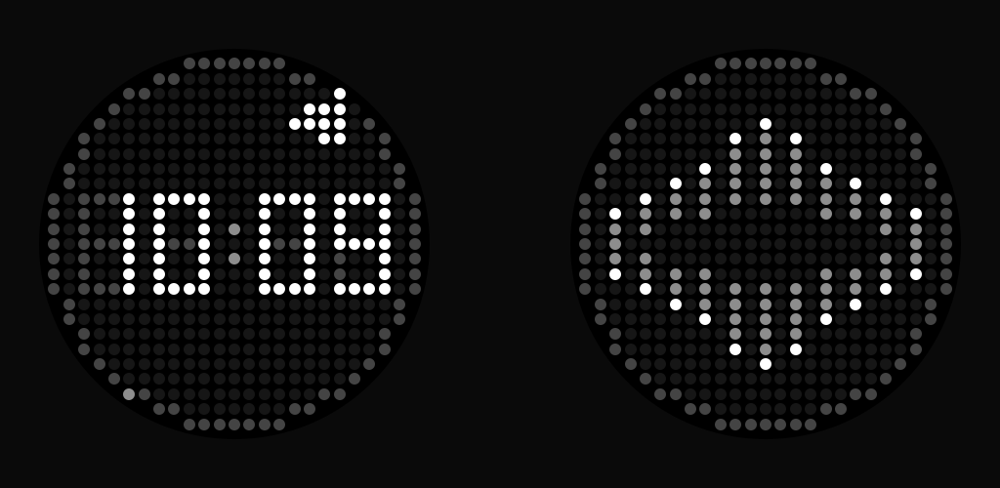
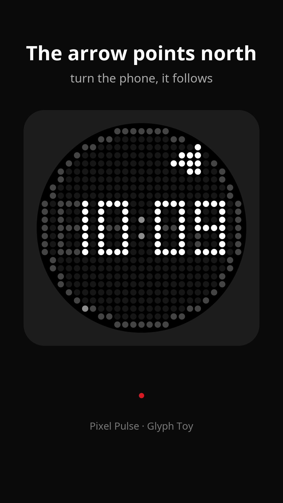
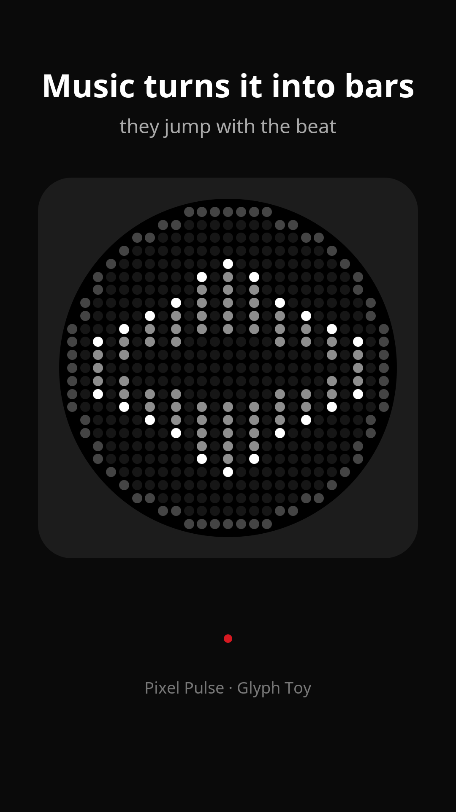
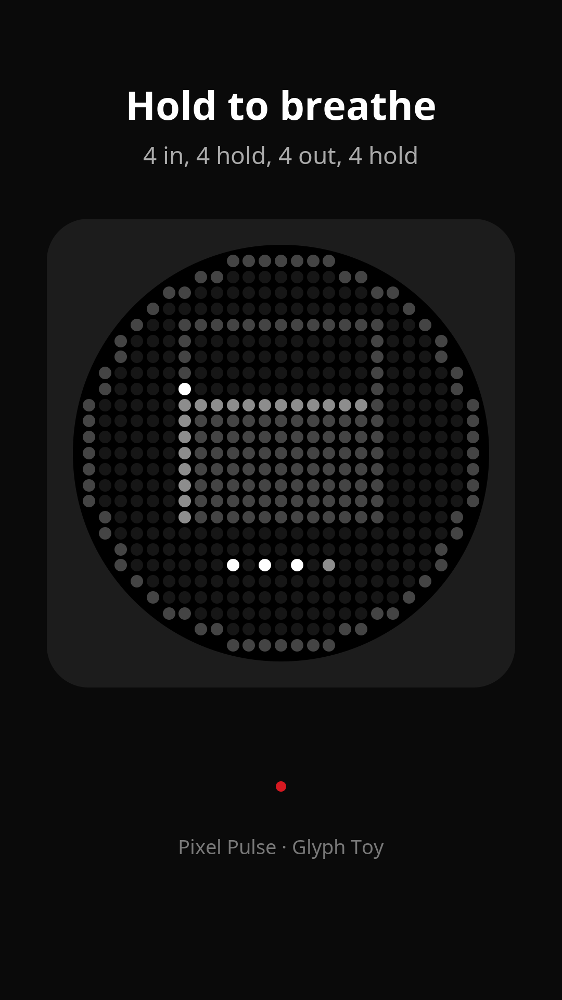
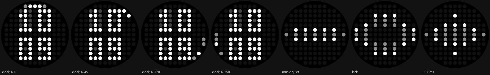

# Pixel Pulse

A retro LED toy for the Glyph Matrix on the back of Nothing phones.

| | |
|---|---|
| **Clock** | The time on one line, like an old scoreboard, with dim "ghost 8s" behind the digits. |
| **North arrow** | A small arrow on the edge points north, flat on a table or in your hand. |
| **Music bars** | Play music and the clock turns into mirrored bars that open and shut on every beat. Voices work too. |
| **Box breathing** | Hold the Glyph Button: a dot walks a box, 4 in · 4 hold · 4 out · 4 hold, with gentle taps. Tap to stop. |
| **Always-on** | Works as your Flip to Glyph always-on toy. |

  

## Phones

| Phone | Matrix | What you get |
|---|---|---|
| Phone (3) | 25×25 | Everything above |
| Phone (4a) Pro | 13×13, always-on only | Clock, north arrow, music bars. No breathing: this phone has no Glyph Button. *Untested on real hardware, reports welcome.* |

## Install

1. Download the latest `PixelPulse-x.y.apk` from [Releases](../../releases) and open it on your phone (allow installing from your browser if asked).
2. Open **Pixel Pulse** and tap **Add to Glyph Toys**.
3. Tap **Allow music bars** if you want the bars to follow your music.
4. Press the Glyph Button on the back until Pixel Pulse shows up.

## Privacy

No ads, no tracking, no network. The microphone permission is only used to read the sound your phone itself is playing (Android's Visualizer), so the bars can move. It never listens to the room and never records. Full policy: [privacy](https://rambo-ai97.github.io/pocket-puzzle-site/pixel-pulse-privacy.html).

## Build it yourself

1. Download `glyph-matrix-sdk-2.0.aar` from Nothing's [GlyphMatrix Developer Kit](https://github.com/Nothing-Developer-Programme/GlyphMatrix-Developer-Kit) into `app/libs/` (it's Nothing's, under their licence, so it isn't in this repo).
2. JDK 17+ and the Android SDK (compileSdk 37), then `./gradlew assembleDebug`.
3. `adb install -r app/build/outputs/apk/debug/app-debug.apk`

Code map: `core/` is plain Java with no Android imports (`Scene` = 25×25 toy, `SmallScene` = 13×13, `Beat` = music-bar motion, `Px` = LED buffer + palette). `PixelPulseService` is the Glyph Toy. `tools/Preview.java` renders a contact sheet of the real scene on a desktop JDK.

## License

MIT for this code. The Glyph Matrix SDK belongs to Nothing Technology Limited.

Made by a small family in Canada, the people behind [Pocket Puzzle](https://play.google.com/store/apps/details?id=com.ramboai97.pocketpuzzle).
